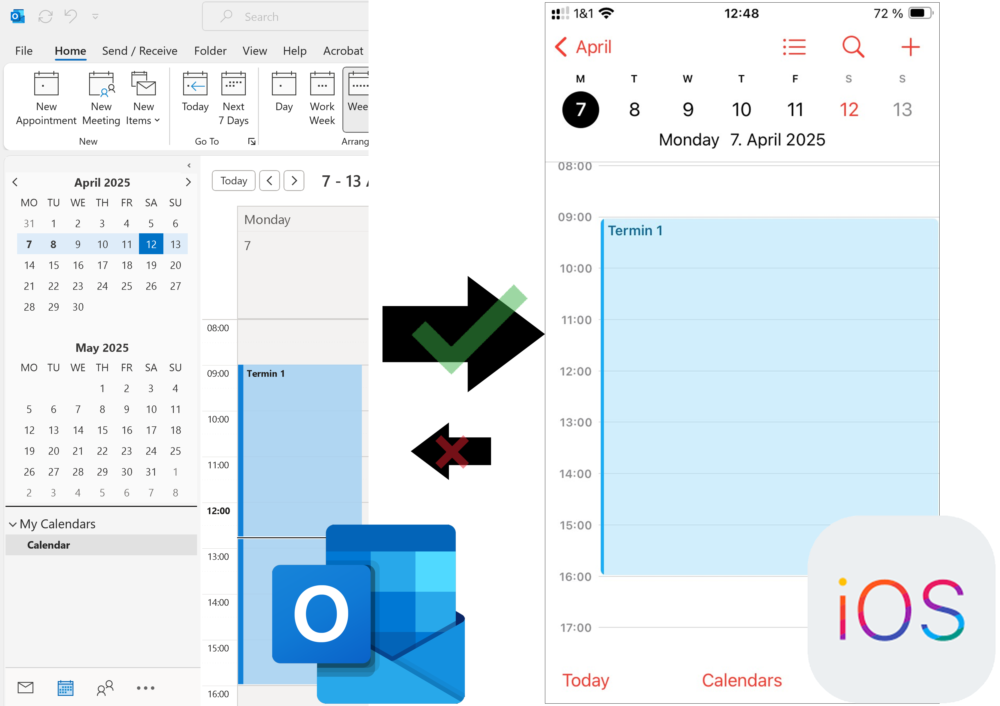
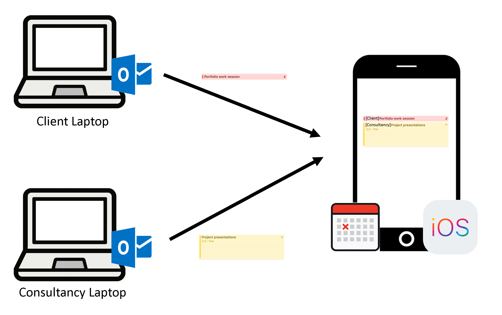

# CalendarSync



CalendarSync is a quiet .NET background application that performs a one-way
sync from local Microsoft Outlook calendars to Apple iCloud Calendar through
CalDAV. It uses Outlook COM interop and needs no Microsoft Graph or Exchange
integration.

## Behavior

- Sync the default Outlook calendar into one iCloud destination. Separate
  instances on different hosts or user sessions can share one destination.
- Identify each source and optionally prefix its events.
- Add 10-minute and 3-minute reminders to timed events. Do not add reminders
  to all-day or multi-day events.
- Run without a main window, show status in a tray icon, and write `sync.log`.
- Work as a per-user Windows Scheduled Task in restricted environments.



## Requirements

- Windows with Outlook configured for the interactive user
- iCloud CalDAV access and an app-specific password
- .NET 8 or newer
- Permission to register a Scheduled Task

## Build and configure

Build a Release package and copy it to a stable path such as
`C:\CalendarSync\`. Copy `config.example.json` to `config.json`, then set:

| Key | Purpose |
| --- | --- |
| `ICloudCalDavUrl` | HTTPS CalDAV endpoint. |
| `ICloudUser`, `ICloudPassword` | Apple ID and app-specific password. |
| `PrincipalId`, `WorkCalendarId` | CalDAV principal and destination calendar. |
| `InitialWaitSeconds`, `SyncIntervalMinutes` | Startup delay and sync cadence. |
| `SyncDaysIntoFuture`, `SyncDaysIntoPast` | Source-local calendar days before and after today. The last day is included. |
| `LogLevel` | Minimum severity for `sync.log`. The default is `Information`. |
| `SourceId` | Stable identifier for one Outlook source. |
| `EventTag` | Optional source prefix, such as `[COMPANY]`. |
| `SourceTimeZoneId`, `TargetTimeZoneId` | Optional source and destination zones. |
| `OutlookBodySyncMode` | `WhenSafe`, `Never`, or `Always`. |

Use browser developer tools or a CalDAV client to find the principal and
calendar IDs. If a time zone is absent, CalendarSync uses the host's local
zone. It validates HTTPS, identifiers, intervals, and windows before startup.
When `SourceId` is empty, it creates a stable ID and replaces the configuration
atomically.

## Scheduled Task

Create a task named `CalendarSync` that runs at user logon:

- Run only while the user is logged on.
- Run with highest privileges.
- Start `C:\CalendarSync\CalendarSync.exe`.

If necessary, run the program once as administrator to register the
`CalendarSync` source for Windows Event Log. The program can run without this
source. See [local diagnostics](#local-diagnostics) for log locations.

## Safety and COM reliability

CalendarSync never syncs from iCloud to Outlook. It sends basic authentication
only over HTTPS. It reads Outlook bodies only when Outlook and Windows report
that protected COM access is quiet. `Always` can trigger Outlook Object Model
Guard prompts.

Outlook work runs on one dedicated STA thread with timeouts. CalendarSync does
not start a second COM operation while a timed-out call is exiting. It makes no
iCloud changes when Outlook cannot produce a complete snapshot. Run the
[COM endurance procedure](docs/com-endurance.md) after a COM change.

Startup uses the same sync as later cycles. An Outlook error, a conflicting
duplicate identity, or a scan limit can make a snapshot incomplete. CalendarSync
does not open an iCloud connection for an incomplete snapshot, including for
`Full Re-Sync`.

CalendarSync requires a complete depth-one CalDAV listing. It stops if the
response indicates a partial listing, a continuation, or an ambiguous resource.
It compares the fields it manages before it uploads an event. It preserves the
remote description when Outlook does not supply the body. It creates events
only at unused URLs. It updates an existing event only when the event UID
matches and the listed revision is current.

Automatic cleanup checks both the resource name and the event UID. It removes
only stale events with the current UID format for the configured `SourceId`.
It requires a current revision and deletes only after all desired events are
unchanged or have passed verification. Verification checks the UID, time or
all-day dates, summary, location, description, and reminders. It never issues
a correction write. A failed or unconfirmed request stops the cycle. It does
not roll back writes or deletes that have already completed.

Use source IDs that differ even when compared without case. Leave legacy copies
in place until you review them. The confirmed `Full Re-Sync` command attempts
to delete all listed `.ics` resources in the destination, including resources
from other sources. The command can stop after some deletes. Use it only when
you intend to remove those events.

CalendarSync retries one rejected authentication request before it stops the
cycle. An event verification read can also retry one HTTP 403 after a successful
write. A persistent HTTP 403 is a request rejection, not a password diagnosis.
Reads can retry a transient status or transport failure once. CalendarSync does
not replay a write with an uncertain result. The next normal cycle reads the
current state instead. A credential notice requires two consecutive HTTP 401 cycles
with no successful iCloud request. A successful request resets this count.
Other failures also reset it. Notices are limited to one per 30 minutes.

## Local diagnostics

- `sync.log` and `sync.log.old` are in the executable directory. Each new file
  is capped at 1 MiB. The newer rollover replaces the older file. The logger
  replaces a single oversized entry with a fixed notice. Existing older logs
  can contain calendar data. Review them under your local retention policy.
- At `Information`, `SyncCycle` records include a schema version, a random
  per-cycle ID, mode, stage, outcome, reason, HTTP status, duration, and counts
  for source events, unavailable bodies, unchanged events, confirmed writes,
  verification, and deletion. Failed cycle summaries use `Warning`. Request
  retries include the operation, attempt, and status or failure class. An
  accepted write without successful verification is distinct from an unchanged
  event or a verified write. A failed conditional request requires a fresh cycle.
- `bootstrap.log` keeps up to 64 KiB of startup and dependency-probe outcomes.
  When it reaches the cap, it starts again. Windows Event Log receives fixed
  lifecycle and failure messages when the source is available. Its retention
  is controlled by Windows, not by `LogLevel`.
- The application does not record event UIDs, event content or times,
  request URLs, credentials, local paths, or exception text in new diagnostics.
  Logging is local only. It does not change the result of the sync.

Use the [release and deployment procedure](docs/releases.md) to deliver a tested
package. Keep the installed configuration and logs when replacing program files.

## Validation

```powershell
.\scripts\Validate.ps1
```

The script performs locked restore, characterization tests, an x86 Release
build, dependency-layout checks, and a package self-test. It stages packages
under the Windows temporary directory. It does not read deployed `config.json`
or contact Outlook or iCloud.

License: MIT. Use at your own risk.
